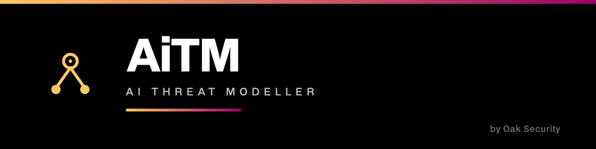

<p align="center">
  
</p>

Local-first application for AI-assisted threat modeling using the
[TRACE](https://github.com/oak-security/TRACE) framework.

- **Local-first**: projects and your API key live on your machine; nothing is uploaded
  except the AI calls you trigger. No accounts, no hosted backend, no telemetry.
- **Bring your own key**: OpenAI or Anthropic, one per provider.
- **TRACE phases**: Scope & Sources → TRACE model → STRIDE → Attack trees →
  Collusion/Coordination → Report. Optional phases toggle per project.
- **Generic**: domain profiles span generic IT, web, cloud, mobile, ICS/OT, and Web3.
- **Three UIs and two programmatic adapters over one application core**: the
  [Electron desktop app](#download--install), [terminal UI](#terminal-ui),
  [local web UI](#local-web-ui), [headless CLI](#programmatic-cli), and
  [HTTP/SSE server](#api-server). All are single-user and share one project store.

AiTM's command is an engine dispatcher; every adapter is selected explicitly:

| Command | Adapter |
| --- | --- |
| `aitm tui [source ...]` | Ink terminal UI |
| `aitm gui` | Electron desktop UI |
| `aitm web` | Browser UI with its local HTTP/SSE transport |
| `aitm -p [command ...]` | In-process programmatic CLI |
| `aitm serve` | API-only HTTP/SSE server |

A bare `aitm` prints usage. The CLI and desktop are separate installations over the
same versioned engine; installing one does not pull in the other.

## Download & install

**macOS (Apple Silicon) is the only platform with a prebuilt download.** Windows and
Linux can be built from source, but those builds are unsigned and untested — see
[Windows & Linux (build from source)](#windows--linux-build-from-source).

### macOS (Apple Silicon)

Get the installer from the **[Releases page](https://github.com/oak-security/aitm/releases/latest)**.
(This is a private repository — sign in to GitHub with an account in the `oak-security`
org to see it.)

1. Download **`AiTM-<version>-arm64.dmg`**.
2. Open the `.dmg` and drag **AiTM** into **Applications**.
3. Launch it from Applications.

The macOS build is signed and notarized, so it opens with no Gatekeeper warning.
Note: **Apple Silicon (M-series) only** — Intel Macs aren't supported yet.

You also need your **own AI API key** (OpenAI or Anthropic) — see "First run" below.

### CLI, TUI, web UI, and API server

The non-Electron modes ship as the private GitHub Package `@oak-security/aitm`. Authenticate
npm to GitHub Packages with an Oak-authorized token carrying `read:packages`, then install
to a user-writable prefix:

```sh
npm login --scope=@oak-security --auth-type=legacy --registry=https://npm.pkg.github.com
npm install --global --prefix "$HOME/.local" @oak-security/aitm
aitm --version
```

Ensure `$HOME/.local/bin` is on `PATH`. This package contains `aitm tui`, `aitm -p`,
`aitm web`, and `aitm serve`; it does not contain Electron. On macOS, `aitm gui` launches
the separately installed AiTM application.

From a source checkout, use the same user-local layout without publishing first:

```sh
npm ci
NPM_CONFIG_PREFIX="$HOME/.local" npm run link:cli
```

### Windows & Linux (build from source)

> **Untested.** The Windows and Linux packages are not code-signed and have not been
> tested on either platform. They are not published as release downloads. Build them
> yourself only if you are willing to debug an unsupported build; the app itself is
> plain Electron, so nothing is known to be broken, but nothing has been verified
> either. Bug reports are welcome, fixes are best-effort.

Prerequisites: Node.js 20+, Git, and repo access. Build on the target platform —
electron-builder does not cross-compile these targets reliably.

```sh
git clone https://github.com/oak-security/aitm.git
cd aitm
npm ci
npm run dist:win     # Windows: NSIS installer -> dist/AiTM-Setup-<version>.exe
npm run dist:linux   # Linux:   dist/AiTM-<version>.AppImage and dist/aitm_<version>_amd64.deb
```

Then install the artifact from `dist/`:

- **Windows** — run `AiTM-Setup-<version>.exe`. Because the build is unsigned,
  SmartScreen shows **"Windows protected your PC"**; click **More info → Run anyway**.
- **Linux, AppImage** (any distro):
  ```sh
  chmod +x AiTM-<version>.AppImage
  ./AiTM-<version>.AppImage
  ```
- **Linux, Debian / Ubuntu** (`.deb`):
  ```sh
  sudo apt install ./aitm_<version>_amd64.deb
  ```

If you would rather not package at all, both non-macOS platforms can run the app
straight from the checkout with `npm start`, or use the
[terminal UI](#terminal-ui) / [local web UI](#local-web-ui), which are
plain Node processes with no packaging step.

### First run

1. Open **Settings** (sidebar, bottom-left).
2. Choose your **provider** (OpenAI or Anthropic), paste your **API key**, and click **Test key**.
3. Click **New** to create a project, add sources, and start modeling — or use
   **Run full pipeline** on the Overview screen for an end-to-end first pass.

Your key is stored encrypted on your device (OS keychain) and is only ever sent to the
provider you select. Projects and settings live in your app-data folder ("Reveal data
folder" in the sidebar).

### Desktop updates

The private repository cannot provide an anonymous Electron update feed, so the desktop
does not pretend to auto-update. Check the [Releases page](https://github.com/oak-security/aitm/releases/latest)
and install the new DMG over the existing application. Update the CLI separately with
the same `npm install --global --prefix ...` command. Windows and Linux desktop builds
must be rebuilt from an updated checkout.

## Usage guide

AiTM implements the [TRACE](https://github.com/oak-security/TRACE) threat-modeling
methodology: ingest what describes the system, build a structured model of it, enumerate
threats with STRIDE, optionally decompose the important ones into attack trees and check
for actor collusion, then produce a report. Every AI output is an **editable draft** — you
review and correct it; the app is an assistant, not an oracle.

### 1. Ingest your sources

On the **Sources & Scope** page (TRACE phases 0–1):

- **Add folder** — a local source/project directory (code, configs, docs). The walk is
  confined to the folder, honors `.gitignore`, and skips binaries/dependency dirs.
- **Add file** — individual files: specification / architecture / whitepaper documents
  (`.md`, `.txt`, `.pdf`, `.docx`) and/or source files.

Add **as many sources as you like** — they're complementary. A typical setup is a
**spec or whitepaper plus the code repo**. Everything is local; nothing is uploaded
until you run an AI step. Then (optionally) fill in **Scope** — boundaries, in/out of
scope, assumptions — and click **Ingest** to classify the system and open the Overview.

### 2. Tip: a good spec beats raw code

TRACE is a **design-level** methodology, so the model reasons best from material that
describes the system's **architecture, components, trust boundaries, assets, and
actors** — i.e. a clear **specification, whitepaper, or design doc**. Pointing it only at
a large code repository tends to produce noisier, lower-altitude results, because the
design intent has to be inferred from implementation detail. **Best results: feed it a
solid spec/whitepaper, and add the code as a supporting source** for grounding.

### 3. Two ways to run it

- **Full pipeline ("Run full pipeline" on the Overview)** — the "I'm feeling lucky" mode.
  Runs every enabled phase end to end (classify → TRACE model → STRIDE → top-3 attack
  trees → coordination → report), auto-approving each step. Great for a fast first pass
  or to scope effort. It **resets prior AI results** first, so it's a clean re-run.
- **Deliberate, phase by phase (recommended for real work)** — generate one phase at a
  time, **review and edit** the tables (assets, actors, invariants, threats, …), mark the
  phase reviewed, then move on. Correcting the TRACE model *before* STRIDE, and STRIDE
  *before* attack trees, materially improves the result. This is the approval-gate
  workflow; the full pipeline just auto-approves those same gates.

A good rhythm: run the full pipeline once for a draft, then walk the phases to refine.

### 4. The TRACE phases

Each phase is in the left nav; **optional ones can be toggled per project** under
**Phases** (disabled phases drop out of the workflow, the pipeline, and the report).

| Phase | What it does |
| --- | --- |
| **0–1 Sources & Scope** | Ingest local sources; record assessment boundaries. |
| **2 TRACE Model** | Structured model: protected assets, threat actors, privileged roles, invariants, components, trust boundaries, value/data flows. |
| **3 STRIDE** | Per-surface threats (Spoofing/Tampering/Repudiation/Info-disclosure/DoS/Elevation) with likelihood, impact, and risk. |
| **4 Attack Trees** *(optional)* | Decompose chosen threats into attack paths — one tree per threat, accumulative. |
| **5 Collusion & Coordination** *(optional)* | Where distinct actor groups (validators, multisig signers, committees, DAOs…) could coordinate to cause harm. Defaults on only when the classification flags it. |
| **6 Report** | Assembles the reviewed model into a design-level report; export to **PDF** or **Markdown**. |

The report is an **AI-assisted, design-level** document — it is not a code audit,
penetration test, or certification, and should be reviewed by an expert before external
use.

## Terminal UI

A keyboard-driven TUI frontend that runs the same pipeline against the same project
store, no Electron window needed. It adds git/GitHub URL ingestion (shallow clone, also
in the web UI below, not in the desktop app) and an AI-applied scope hint that reduces
the ingested file set ("only the docs directory"). Programmatic mode reuses both.

```sh
npm run tui -- [source ...]              # source checkout

aitm tui                                 # current directory
aitm tui docs/arch.md spec.pdf           # specific files
aitm tui https://github.com/owner/repo   # shallow-cloned, clone removed after
```

API keys come from `OPENAI_API_KEY` / `ANTHROPIC_API_KEY` or the TUI's own key file;
the desktop app's OS-keychain vault is Electron-only. See `packages/cli/docs/tui.md`.

## Local web UI

The same renderer served in your browser instead of an Electron window, running the same
pipeline against the same project store. Single user, no authentication, bound to
loopback: it is a third frontend, not a hosted service. It adds the TUI's git/GitHub URL
ingestion, and uses browser file pickers in place of the native dialogs.

```sh
npm install
npm run web        # equivalent to: aitm web
# http://localhost:8790
```

Projects and settings are shared with the desktop app and the TUI; API keys come from
`OPENAI_API_KEY` / `ANTHROPIC_API_KEY` or the same key file `aitm-tui` uses (the desktop
app's OS-keychain vault is Electron-only). Since there is no authentication, do not bind
it to a non-loopback address; forward the port over SSH instead. See
`packages/cli/docs/server.md`.

## Programmatic CLI

`aitm -p` runs against the application core in-process; no web server is required.
Progress goes to stderr, while the report or requested data goes to stdout so commands
can be scripted. Add `--json` for structured project/list/status output.

```sh
aitm -p ./architecture                # ingest, run every enabled phase, print report
aitm -p new ./docs --name "Payments"  # ingest only; prints the project id
aitm -p projects --json               # list shared projects
aitm -p stride <project-id>           # run one phase
aitm -p pipeline <project-id> --reset # clean re-run of the full pipeline
aitm -p export <project-id> > report.md
```

Use `aitm --help` for the full command and model/provider option list. Keys come from
the same environment variables or non-Electron key file as the TUI and web UI.

## API server

`aitm serve` starts the API-only HTTP/SSE adapter. It does not serve the browser UI;
use `aitm web` for that. The server binds `127.0.0.1:8790` by default.

```sh
aitm serve
curl http://127.0.0.1:8790/api/healthz
curl http://127.0.0.1:8790/api/commands
curl -sS -X POST http://127.0.0.1:8790/api/rpc \
  -H 'content-type: application/json' \
  -d '{"channel":"projects.list","payload":{}}'
```

The command interface includes `pipeline.step` and `pipeline.run`; live provider
progress is available from `GET /api/stream`. This is still AiTM's local, single-user
server: there is no built-in authentication. Keep it on loopback or put it behind an
authenticated TLS tunnel/proxy. See `packages/cli/docs/server.md` for the complete surface.

## Develop

```sh
npm install
npm run dev        # launch with devtools
npm start          # launch
npm run aitm -- --help
npm run check      # syntax check
npm test           # unit tests
npm run pack:check # verify published package contents
```

## Build installers

```sh
npm run dist        # current platform
npm run dist:mac    # macOS .dmg + .zip        (shipped)
npm run dist:win    # Windows NSIS             (unsigned, untested)
npm run dist:linux  # AppImage + .deb          (unsigned, untested)
```

Local builds are unsigned. Release CI requires all signing and notarization credentials
and refuses to publish without them; see [electron-builder.js](electron-builder.js).

The Windows and Linux targets remain configured so a local build works, but they are not
signed, not tested, and not published to releases.

## Release (CI)

All four manifests and the lockfile use one version. Set it with:

```sh
npm run version:set -- 0.3.1
npm install --package-lock-only
npm run verify:release -- v0.3.1
```

Pushing the matching `v*` tag runs [.github/workflows/release.yml](.github/workflows/release.yml).
The workflow installs from the lockfile, runs syntax checks, all tests, verifies package
contents, and rejects a tag/version mismatch before publishing anything. It then:

- publishes the engine, shared workbench, and Electron-free `@oak-security/aitm` CLI to
  GitHub Packages;
- builds an explicit Apple Silicon (`arm64`) desktop artifact; and
- publishes a non-draft GitHub Release containing the signed and notarized DMG/ZIP.

Windows and Linux are deliberately not built in CI. All of these repository secrets are
required; a release fails rather than silently producing an unsigned macOS build:

| Secret | Meaning |
| --- | --- |
| `MAC_CSC_LINK` | base64 of the Developer ID Application `.p12` |
| `MAC_CSC_KEY_PASSWORD` | password for that `.p12` |
| `APPLE_ID` | Apple ID email |
| `APPLE_APP_SPECIFIC_PASSWORD` | app-specific password |
| `APPLE_TEAM_ID` | team id (e.g. `V863M8NPN9`); also enables notarization |

```sh
git tag v0.3.1 && git push origin v0.3.1
```

Export the cert for `MAC_CSC_LINK`: `base64 -i DeveloperID.p12 | pbcopy`.

## Documentation

- [AGENT.md](AGENT.md) — build/run conventions and the security/branding invariants.
- [SPEC.md](SPEC.md) — product and technical specification.
- [packages/engine/README.md](packages/engine/README.md) — the UI-independent engine.
- [packages/cli/README.md](packages/cli/README.md) — the separately installed CLI.
- [packages/cli/docs/tui.md](packages/cli/docs/tui.md) — the terminal frontend.
- [packages/cli/docs/server.md](packages/cli/docs/server.md) — web and server adapters.

## Data location

All modes share one data directory: `~/Library/Application Support/AiTM`
(macOS), `%APPDATA%\AiTM` (Windows), `~/.config/AiTM` (Linux), holding `projects/*.json`
and `settings.json`. A project created in one mode opens in every other mode.
`AITM_DATA_DIR` overrides it for all non-Electron modes. The desktop app's sidebar has a
"Reveal data folder" link.

API keys are the exception, because the OS keychain is only reachable from Electron:

| Frontend | Key storage |
| --- | --- |
| Desktop | `keystore.bin` in the data dir, encrypted via the OS keychain |
| TUI, web, CLI, server | `OPENAI_API_KEY` / `ANTHROPIC_API_KEY`, else `~/.config/aitm-tui/keys.json` (mode 600) |

So a key entered in the desktop app is not visible to non-Electron modes, and vice versa.

## License

Proprietary. All rights reserved.
